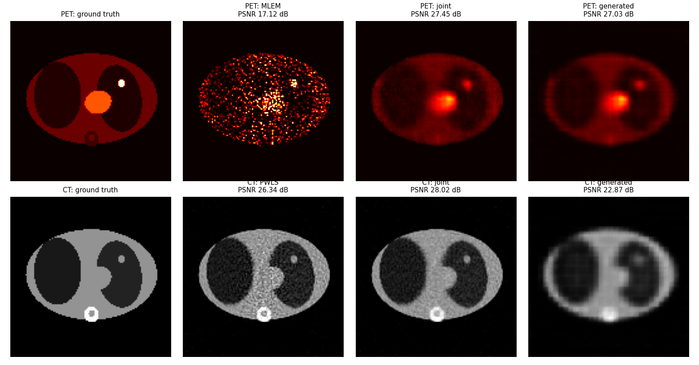

# DeepSynergyPETCT

Synergistic PET/CT reconstruction with a **patch-based multi-branch generative prior**: a two-branch β-VAE learns paired PET/CT patches, and its shared latent code couples the two reconstructions so each modality benefits from the other.

This is the reference implementation of the method in the papers and thesis below (thesis Ch. 5, IEEE TRPMS 2025). It ships with a synthetic thorax phantom, so the full pipeline (simulate → train → reconstruct) runs on a laptop CPU in about 10 minutes.



## Method

For PET activity $x_1$ and CT attenuation $x_2$, the prior is

```math
R(x_1, x_2) = \sum_{p} \min_{z} \; \eta \,\bigl\| G_1(z) - s_1 P_p x_1 \bigr\|_2^2 + (1-\eta) \,\bigl\| G_2(z) - s_2 P_p x_2 \bigr\|_2^2 + \alpha \|z\|_2^2
```

where $G = (G_1, G_2)$ is the two-branch decoder, $P_p$ extracts patch $p$, and $s_1, s_2$ are the training normalisation constants. Reconstruction alternates:

1. **$z$-update**: fit one latent code per patch to the current PET and CT patches (all patches in a single batched L-BFGS);
2. **PET update**: attenuation-corrected MLEM surrogate plus the quadratic prior, solved in closed form;
3. **CT update**: PWLS separable surrogate plus the quadratic prior, solved in closed form.

PET attenuation correction uses the 511 keV map derived from the reconstructed CT, as in a clinical PET/CT workflow.

## Install

Python 3.9–3.11 (TensorFlow 2.15).

```bash
python -m venv .venv && source .venv/bin/activate
pip install -e ".[dev]"            # add ",astra" for the fan-beam CT projector (Linux/Windows)
pytest                             # 17 tests, ~5 s
```

ASTRA is optional: by default CT uses a built-in parallel-beam projector. On macOS, install ASTRA with conda (`conda install -c astra-toolbox astra-toolbox`).

## Quickstart (synthetic phantom)

```bash
python scripts/make_phantoms.py --n 400 --seed 0   --out data/train.npz
python scripts/make_phantoms.py --n 5   --seed 123 --out data/test.npz

python scripts/train.py --data data/train.npz --vox-mm 3.9 --patch 32 --stride 8 \
    --latent-dim 32 --filters 32 --layers 3 --epochs 20 --out models/phantom      # ~8 min on CPU

python scripts/reconstruct.py --config configs/phantom.json --model models/phantom \
    --data data/test.npz --index 0 --out results/phantom                          # ~1 min
```

`results/phantom/` contains `metrics.json`, `images.npz` and `comparison.png`.

### Phantom results (4 test phantoms, mean ± std)

Low-count PET (≈2·10⁴ counts) and low-dose CT (I₀ = 2000), 128×128, 120 angles. Baselines get the same number of data updates as the synergistic reconstruction.

| | PSNR (dB) | SSIM |
|---|---|---|
| PET: MLEM (170 it.) | 15.7 ± 1.9 | 0.59 |
| PET: MLEM, best iteration (oracle early stopping) | 25.5 ± 1.5 | 0.77 |
| **PET: synergistic** | **26.4 ± 1.1** | **0.87** |
| CT: PWLS (520 it.) | 25.3 ± 0.8 | 0.80 |
| **CT: synergistic** | **27.5 ± 0.4** | **0.83** |

These numbers come from a small model trained for 20 epochs on simple phantoms; they demonstrate the pipeline and aren't a benchmark. See the papers for results on clinical data.

## Using your own data

Every script reads `.npz` files with two arrays of the same shape `(N, n, n)`:

- `pet`: activity, normalised to [0, 1] (e.g. clip, then divide by a fixed maximum)
- `ct_hu`: CT in Hounsfield units

Then set `image.size` / `image.vox_mm` in a config. `configs/thesis.json` holds the parameters used for the 512×512 clinical experiments (fan-beam CT via ASTRA, 64×64 patches, stride 16). The thesis training setting is in the docstring of `scripts/train.py`.

Models trained with the original thesis code (SavedModel `decoder/` folder) can be loaded by passing their normalisation constants: `--pet-scale … --ct-scale …`.

## Repository layout

```
deepsynergy/
  physics/      projectors (rotation-based, ASTRA fan-beam), PET MLEM, CT PWLS, HU / attenuation conversions
  models/       two-branch β-VAE (loss types H and B)
  prior.py      patch operator, batched latent fitting
  recon.py      synergistic reconstruction loop
  experiment.py data simulation from a config
  data.py       synthetic phantoms, training patches
scripts/        make_phantoms.py, train.py, reconstruct.py
configs/        phantom.json (demo), thesis.json (clinical setting)
tests/          pytest suite
```

The original thesis-era code is preserved under the git tag `v0-thesis-snapshot`. `AUDIT.md` lists the issues fixed in this version.

## Citation

- N. J. Pinton, A. Bousse, C. Cheze-Le Rest, and D. Visvikis, **"Multi-Branch Generative Models for Multichannel Imaging With an Application to PET/CT Synergistic Reconstruction,"** *IEEE Trans. Radiat. Plasma Med. Sci.*, 2025. DOI: [10.1109/TRPMS.2025.3532176](https://doi.org/10.1109/TRPMS.2025.3532176)
- N. J. Pinton, A. Bousse, Z. Wang, C. Cheze-Le Rest, V. Maxim, C. Comtat, F. Sureau, and D. Visvikis, **"Synergistic PET/CT Reconstruction Using a Joint Generative Model,"** *Fully3D*, 2023. [arXiv:2411.07339](https://arxiv.org/abs/2411.07339)
- N. J. Pinton, A. Bousse, C. Cheze-Le Rest, and D. Visvikis, **"Joint PET/CT Reconstruction Using a Double Variational Autoencoder,"** *IEEE NSS/MIC*, 2023. DOI: [10.1109/NSSMICRTSD49126.2023.10337812](https://doi.org/10.1109/NSSMICRTSD49126.2023.10337812)
- N. J. Pinton, **"Synergistic PET/CT Reconstruction Using Deep Learning,"** Ph.D. dissertation, Univ. Bretagne Occidentale, 2024. [tel-04996652](https://theses.hal.science/tel-04996652)

## License

See [LICENSE](LICENSE).
